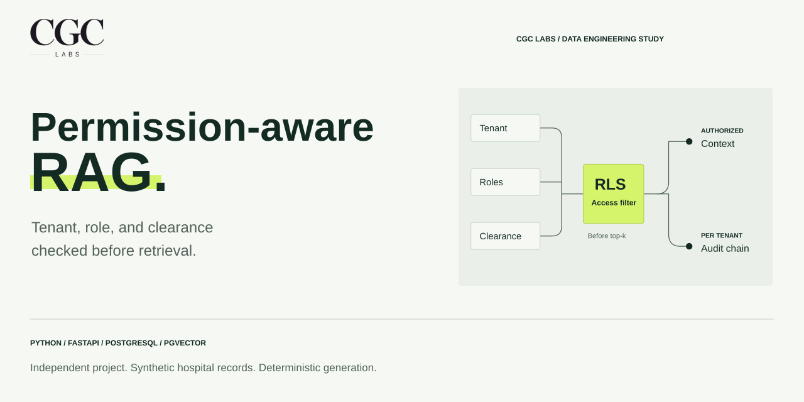
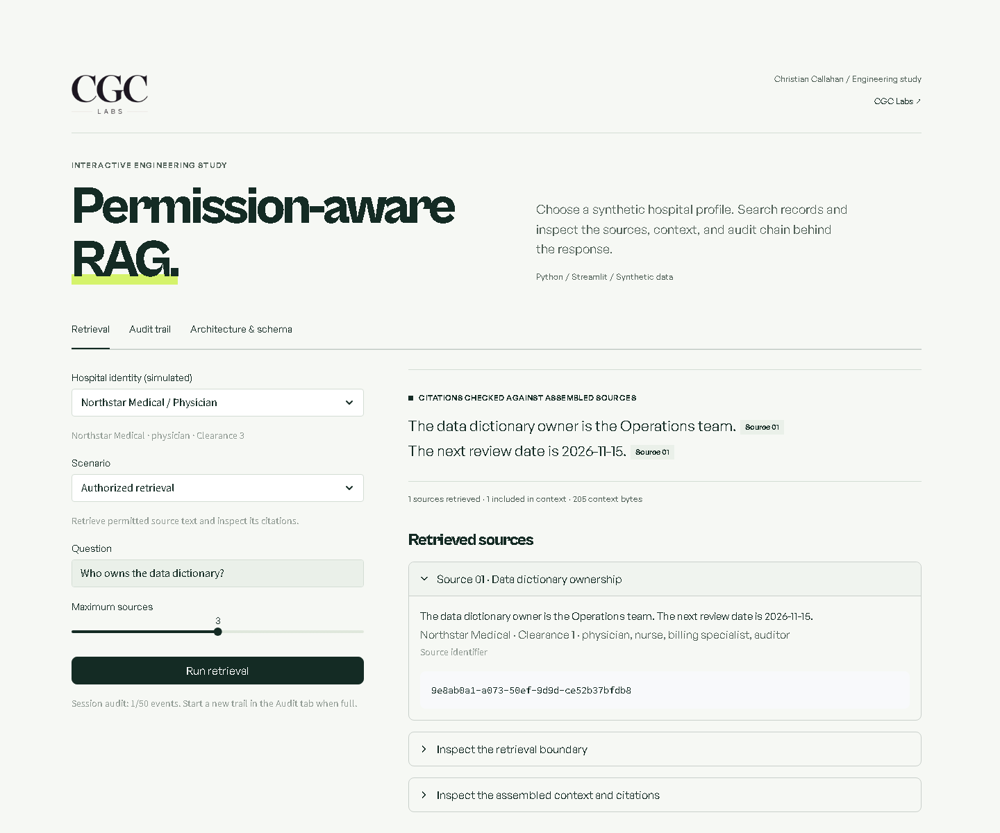
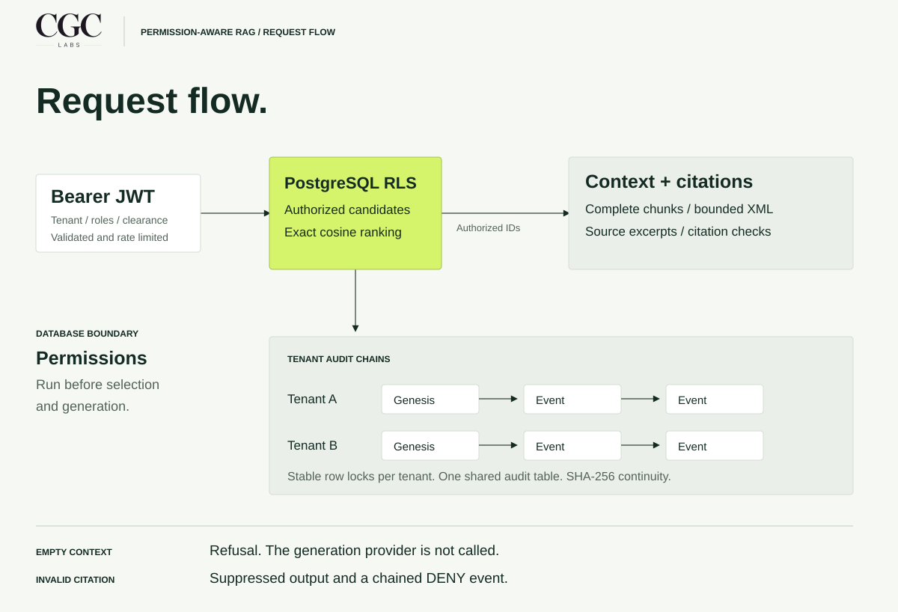
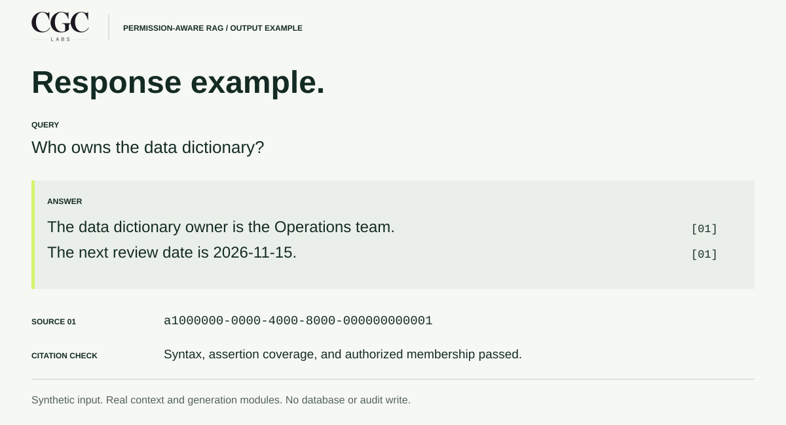
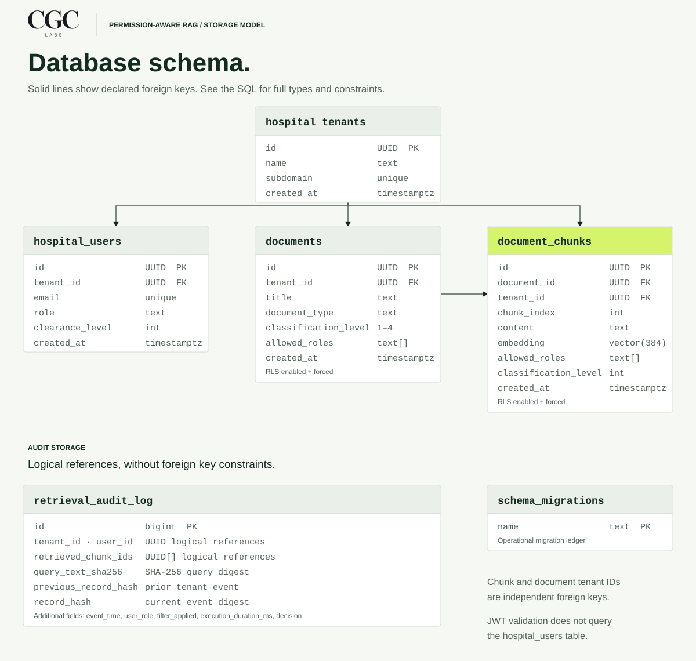

# Permission-aware RAG

How can staff search internal guidance while only using records their organization and role allow? This Streamlit explorer makes those permission decisions inspectable using synthetic hospital records.

The public demo runs with **Python and Streamlit**. The repository also includes the separate **FastAPI, PostgreSQL, and pgvector** service. Both use synthetic records and deterministic generation.

An independent project by [Christian G. Callahan](https://www.christiangcallahan.tech/), presented through [CGC Labs](https://cgclabs.org/), a data engineering consulting firm.

[Streamlit app](#streamlit-app) · [Architecture](#architecture) · [Deploy](docs/streamlit-deployment.md) · [Portfolio integration](docs/portfolio-integration.md) · [Verification](docs/verification.md)

## Streamlit app

```powershell
python -m pip install -r portfolio_app/requirements.txt
python -m streamlit run streamlit_app.py
```

The app needs no database, model download, or API key. Choose a simulated hospital identity, enter a question, and inspect the answer, sources, and citations.



| Explore | What happens |
|---|---|
| Authorized retrieval | Local Python permission filters run before lexical cosine ranking. |
| Cross-tenant ranking | Matching records belonging to another hospital stay outside the authorized candidate set. |
| Retrieved instruction attack | The real context assembler quarantines a synthetic attack chunk. |
| Fabricated citation | A deliberately faulty demo provider triggers output suppression and a DENY audit event. |
| No matching records | Empty context produces a refusal without calling the provider. |
| Audit trail | Verify the session's tenant chains, alter a copy to detect tampering, or start a new trail. |

The audit uses the backend's actual hash algorithm, with a limit of 50 events per browser session. It is not durable audit storage. Simulated profile selection is not authentication, and this public app does not execute PostgreSQL RLS.

For Community Cloud, select **`portfolio_app/streamlit_app.py`**. Its adjacent pinned requirements file provides the small hosting environment. Both entrypoints load the same app.

[Deployment guide](docs/streamlit-deployment.md) · [Add it to Christian's portfolio](docs/portfolio-integration.md)

The current local suite passed **151 tests**; **12 PostgreSQL cases skipped** without `TEST_DATABASE_URL`. Streamlit service and interaction coverage accounts for **57** of those passing cases. [Streamlit verification](docs/streamlit-verification.md) records the browser flows and remaining hosted checks.

## The engineering problem

A close vector match can still belong to another tenant or exceed a user's clearance. This project applies permissions in PostgreSQL before ranking records. Authorized chunk identifiers then carry through context assembly and answer verification.

Each retrieval records its query digest and returned chunk identifiers in a tenant-specific audit chain.

## Architecture

The diagram below describes the database-backed service. The Streamlit app demonstrates its permission boundaries locally and reuses its context, generation, and hash implementations.



| Decision | Implementation | Tradeoff |
|---|---|---|
| Apply permissions before top-k selection | Forced RLS filters tenant, role, and clearance; a materialized candidate set receives exact cosine ranking. | The shared HNSW index remains installed but is not used by this retrieval path. |
| Keep audit writes independent across tenants | Stable tenant-row locks protect separate SHA-256 chains, including the first event. | Writes within one tenant still serialize. |
| Bound the context before generation | Include complete chunks within a 2,048-byte default budget; quarantine known attack signatures and escape XML. | Pattern matching cannot identify every indirect injection. |
| Check references after generation | Verify citation syntax, assertion coverage, and membership in assembled context; suppress invalid output. | Reference checks do not prove factual or clinical accuracy. |

The default provider returns sanitized source excerpts with citations. Empty usable context bypasses the provider and returns a deterministic refusal.

## Example output



```powershell
python -m examples.generate_response
python -m examples.generate_response --json
```

The example runs the real context and generation modules with a fixed synthetic operations note. It does not perform database retrieval or persist an audit event. The JSON retains full UUID citations and a null audit hash.

[Inspect the JSON](examples/response.json) · [Read the three response outcomes](docs/output.md) · [View the example source](examples/generate_response.py)

## Data model

Five tables hold tenants, users, documents, chunks, and retrieval audit events. A separate ledger records applied migrations.

<details>
<summary>View the database diagram</summary>



</details>

[Schema reference](docs/schema.md) · [Mermaid source](docs/schema.mmd) · [SQL migrations](migrations)

## Verified behavior

The recorded database run passed **106 tests**, including **ten adversarial security vectors**. Twenty simultaneous requests committed exactly twenty audit events with intact tenant chains.

| Check | Observed result |
|---|---|
| Tenant, role, and clearance attacks | Returned chunk identifiers matched the authorized fixture sets. |
| Top-k starvation | Higher-scoring records from another tenant did not displace authorized records. |
| Audit concurrency and tampering | Concurrent chains remained intact; covered payload changes were detected. |
| Generation boundaries | Known injection chunks were quarantined; unknown citations were suppressed; empty context bypassed generation. |
| Tenant lock independence | Another tenant completed a retrieval while one tenant's audit lock remained held. |

Tests ran on **PostgreSQL 18.4 / pgvector 0.8.7** with deterministic embeddings. PostgreSQL 16 execution and latency targets remain unverified.

[Verification record and limits](docs/verification.md) · [Adversarial tests](tests/test_adversarial_security.py)

## Run it

Use Python 3.11 or newer. Database tests need a disposable PostgreSQL database with native pgvector.

For the Streamlit app alone, use the smaller environment in [Streamlit app](#streamlit-app). The commands below install the complete development environment, including the backend:

```powershell
python -m pip install -r requirements.txt
python -m examples.generate_response
python -m pytest tests -q
```

Set `TEST_DATABASE_URL` to run the database tests. Without it, those tests skip. Service startup also requires separate runtime and migration credentials; follow the [setup guide](docs/operations.md).

## Repository map

```text
app/                  Authentication, retrieval, context, generation, audit
demo/                 Synthetic corpus, local ranking, session audit logic
streamlit_app.py      Interactive CGC Labs portfolio app
streamlit_ui.py       Shared branding and rendered response helpers
portfolio_app/        Community Cloud entrypoint and pinned demo dependencies
.streamlit/           Brand theme; secrets remain ignored
migrations/           Schema, RLS policies, audit index, runtime permissions
tests/                Adversarial integration tests and focused unit cases
examples/             Executable synthetic output and its JSON response
docs/
  assets/             Vector artwork and sharing images
  schema.md           Tables, keys, constraints, and retrieval indexes
  operations.md       Environment, setup, grants, and operating limits
  verification.md     Recorded checks and their scope
  portfolio.md        Project card and case-study copy
  github-about.md     Repository description and topics
  preview.html        Local visual preview
scripts/              Reproducible presentation assets
```

## Project scope

This is an independent engineering project using synthetic records. The Streamlit demo uses local filtering and lexical search. Database RLS and concurrency belong to the separate backend. Neither implementation has an external LLM integration or production deployment evidence. Citation checks establish reference structure and authorized membership. They do not establish clinical safety or healthcare compliance.

The [operating limits](docs/operations.md) cover process-local rate limiting, trusted identity issuance, audit hash coverage, and migration cutover requirements.

[Portfolio copy](docs/portfolio.md) · [GitHub About copy](docs/github-about.md) · [Visual preview](docs/preview.html) · [Presentation assets](docs/presentation.md)
