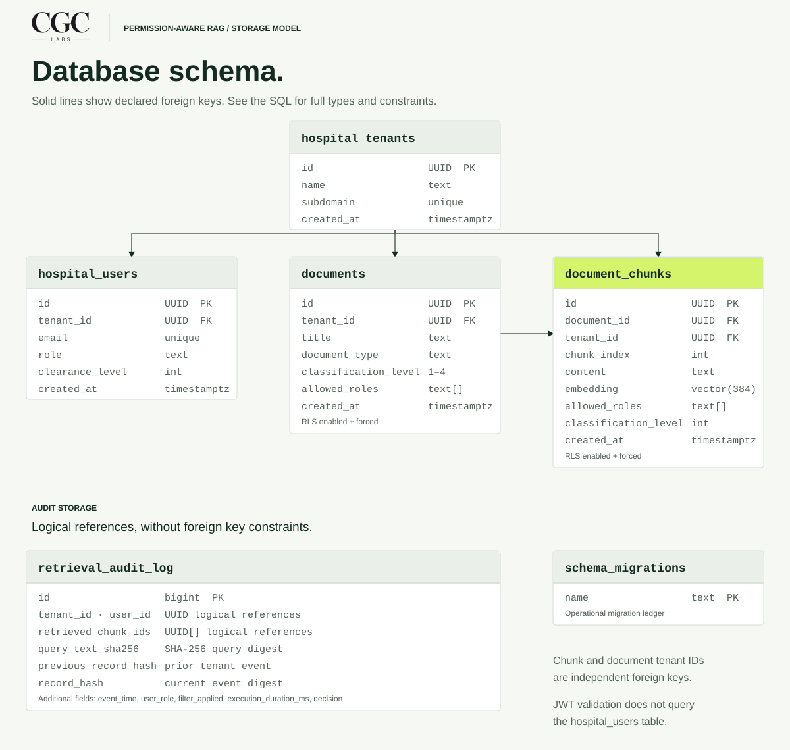

# Database schema

Documents belong to hospital tenants. Chunks hold searchable text, a 384-dimensional embedding, and the permissions used during retrieval.

[Mermaid source](schema.mmd) · [Initial schema](../migrations/001_initial_schema.sql) · [Audit index migration](../migrations/002_tenant_audit_partitioning.sql)

## Table grain

| Table | One row represents |
|---|---|
| `hospital_tenants` | A hospital tenant with a unique subdomain. |
| `hospital_users` | A user assigned to one tenant. |
| `documents` | A document with a tenant, role list, and classification level. |
| `document_chunks` | An embedded text chunk with its own retrieval permissions. |
| `retrieval_audit_log` | A retrieval decision and one link in its tenant's hash chain. |
| `schema_migrations` | An applied SQL migration filename. |

All columns are non-null. Entity tables use UUID primary keys; the audit log uses a sequence-backed integer. The migration ledger uses the filename as its primary key.

## Relationships and boundaries

The database declares four foreign keys:

| Child column | Parent key |
|---|---|
| `hospital_users.tenant_id` | `hospital_tenants.id` |
| `documents.tenant_id` | `hospital_tenants.id` |
| `document_chunks.tenant_id` | `hospital_tenants.id` |
| `document_chunks.document_id` | `documents.id` |

Each child must reference an existing parent. Parents may have no children. All four foreign keys use `ON DELETE CASCADE`.

The chunk's tenant and its document's tenant are independent foreign keys. There is no composite constraint requiring them to match. Ingestion writes matching values. Chunk roles and classification are also stored separately from the document's policy.

Audit `tenant_id`, `user_id`, and `retrieved_chunk_ids` are logical references. They have **no foreign key constraints** and receive no cascading deletes. The audit chain is linked by stored hashes, not a self-referencing foreign key.

`hospital_users` does not serve as the runtime authentication directory. The service validates JWT signatures and claim shapes independently. It does not look up the user, tenant membership, or assigned roles in that table during authentication.

RLS is enabled and forced on `documents` and `document_chunks`. Retrieval binds the signed tenant, roles, and clearance to transaction-local settings. See the [request and deployment boundaries](../README.md).

## Retrieval and audit indexes

| Index | Definition |
|---|---|
| `idx_chunks_embedding_hnsw` | HNSW on `embedding vector_cosine_ops`; `m=16`, `ef_construction=64`. |
| `idx_chunks_tenant_roles` | B-tree on `(tenant_id, classification_level)`. |
| `idx_chunks_roles_gin` | GIN on `allowed_roles`. |
| `idx_docs_tenant` | B-tree on `(tenant_id, classification_level)`. |
| `idx_audit_tenant_time` | B-tree on `(tenant_id, event_time DESC)`. |
| `idx_audit_tenant_id_desc` | B-tree on `(tenant_id, id DESC)`. |

Primary keys also have backing indexes. Tenant subdomains and user email addresses have unique constraints.

Retrieval materializes authorized tenant candidates before exact cosine ranking and `LIMIT`. This path retains the HNSW index without using it for approximate ranking. It trades approximate-search speed for complete ranking of the authorized candidate set; latency has not been benchmarked.

Audit writers lock the stable tenant row before reading the latest chain hash. The tenant/ID index supports that lookup and ordered verification. The migration runner creates `schema_migrations` separately from the initial schema; see [database.py](../app/database.py).
